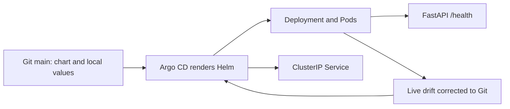

# Aegis GitOps

The deployment configuration repository for Aegis CI/CD. Application source and
release workflows live separately in [aegis-cicd](https://github.com/prasanthece42/aegis-cicd).

Current scope is Phase 5: public GitOps configuration with protected DEV, STAGING
and PROD branches. DEV and STAGING run the same validated multi-platform image in
local Kind. PROD PR #3 was independently reviewed after explicit user approval, merged with all
checks passing, and deployed three healthy replicas in local Kind.
See [release management](DOCS/04-release-management.md).



Verified [GitHub chart validation](https://github.com/prasanthece42/aegis-gitops/actions/runs/40249510939) passes.

## Project structure

```text
charts/sample-api/
  Chart.yaml                 Chart identity and supported Kubernetes versions
  values.yaml                Secure defaults and published image digest
  values.schema.json         Required digest, replicas, and resource input validation
  templates/                 Deployment, Service, ServiceAccount, helpers, notes
argocd/                      Application, project boundaries, and controller config
environments/
  local/                     Historical Phase 3/4 native image overlay
  cluster-kind/              Active exact-image cache pull policy
  dev/                       Namespace + one replica
  staging/                   Two replicas, manual Argo sync, staging branch
  prod/                      Three replicas, prod branch; pending human review
scripts/validate-chart.sh     Lint, render, Kubernetes schemas, and negative cases
.github/workflows/validate.yml Chart and trusted-main promotion checks
.github/workflows/promote.yml Repo-scoped token creates digest promotion PRs
policies/release.json          Source, health and human reviewer allowlists
DOCS/                        Architecture, setup, and verification evidence
```

## Validate locally

Prerequisites: Helm 4.2.4 and kubeconform 0.8.0. First validation needs network access
to versioned Kubernetes JSON schemas. Run:

```bash
bash scripts/validate-chart.sh
```

The script validates all three environments plus the local profile against Kubernetes 1.35 schemas and
checks that missing/malformed digests and zero replicas are rejected. There are no
rendered Secrets or credentials in this repository. `imagePullSecrets` accepts names
of pre-provisioned secrets; it never embeds registry passwords.

## Run DEV locally

Use the application [Phase 5 guide](https://github.com/prasanthece42/aegis-cicd/blob/main/DOCS/20-release-management-guide.md).
Argo reads this public repository over HTTPS without a deploy key. A verified OCI
bundle imports the private GHCR release into the local Kind cache without a registry
PAT. Active Applications use environment values plus cluster-kind pull policy.

Namespace manifests enable the Restricted Pod Security policy at v1.35. The chart
sets non-root UID/GID 10001, a read-only root filesystem, dropped capabilities,
RuntimeDefault seccomp, no privilege escalation, resource requests/limits, rolling
updates, and startup/readiness/liveness probes. A ClusterIP Service provides internal
routing; port-forwarding is the local access path. No ingress or load balancer is needed.

## Documentation index

| Guide | Purpose |
| --- | --- |
| [Architecture](DOCS/01-architecture.md) | Repository boundaries and chart design |
| [Verification](DOCS/02-verification.md) | Historical Phase 3 results and limitations |
| [Argo CD](DOCS/03-argocd.md) | Historical Phase 4 reconciliation and authentication |
| [Release management](DOCS/04-release-management.md) | Current branch controls, health gates and digest promotion |

DEV and STAGING reference the same tested OCI index; promotion preserves that digest.
Each production promotion needs a fresh independent human review, successful checks, merge, and explicit
Argo sync. CI never receives Kubernetes credentials. Health observations expire after
24 hours and are operator-attributed, not signed attestations. All deployments are local.
