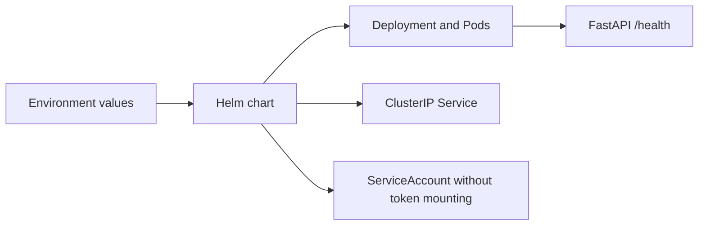

# Aegis GitOps

The deployment configuration repository for Aegis CI/CD. Application source and
release workflows live separately in `../aegis-cicd`.

Current scope is Phase 3: a Helm chart and environment values. DEV is manually
installed into a local Kind cluster from the workstation. Argo CD, automated
reconciliation, promotion approvals, and cross-repository updates are later phases.



## Project structure

```text
charts/sample-api/
  Chart.yaml                 Chart identity and supported Kubernetes versions
  values.yaml                Secure defaults and published image digest
  values.schema.json         Required digest, replicas, and resource input validation
  templates/                 Deployment, Service, ServiceAccount, helpers, notes
environments/
  dev/                       Namespace + one replica
  staging/                   Namespace + two replicas (rendered only)
  prod/                      Namespace + three replicas (rendered only)
scripts/validate-chart.sh     Lint, render, Kubernetes schemas, and negative cases
.github/workflows/validate.yml Static validation only; no cluster credentials
DOCS/                        Architecture, setup, and verification evidence
```

## Validate locally

Prerequisites: Helm 4.2.4 and kubeconform 0.8.0. First validation needs network access
to versioned Kubernetes JSON schemas. Run:

```bash
bash scripts/validate-chart.sh
```

The script validates all three environments against Kubernetes 1.35 schemas and
checks that missing/malformed digests and zero replicas are rejected. There are no
rendered Secrets or credentials in this repository. `imagePullSecrets` accepts names
of pre-provisioned secrets; it never embeds registry passwords.

## Run DEV locally

Use the application repository's `scripts/bootstrap-local-k8s.sh` and
`scripts/verify-local-k8s.sh`; see its DOCS/14-kubernetes-helm-guide.md. It creates an
isolated `kind-aegis-dev` context and loads a scanned native image using a generated,
gitignored local digest override. It does not change the tracked GHCR desired state.

Namespace manifests enable the Restricted Pod Security policy at v1.35. The chart
sets non-root UID/GID 10001, a read-only root filesystem, dropped capabilities,
RuntimeDefault seccomp, no privilege escalation, resource requests/limits, rolling
updates, and startup/readiness/liveness probes. A ClusterIP Service provides internal
routing; port-forwarding is the local access path. No ingress or load balancer is needed.

## Documentation index

| Guide | Purpose |
| --- | --- |
| [Architecture](DOCS/01-architecture.md) | Repository boundaries and chart design |
| [Verification](DOCS/02-verification.md) | Local/remote results and limitations |

Tracked DEV/STAGING/PROD values reference the verified Phase 2 GHCR digest. Those
values do not grant permission to deploy STAGING or PROD; only DEV is installed here.
A digest does not supply registry authentication. The private GHCR image remains
linux/amd64; direct GHCR pulls and multi-platform release support are separate work.
