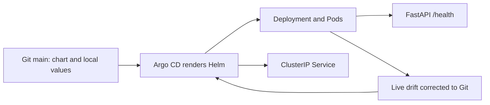

# Aegis GitOps

The deployment configuration repository for Aegis CI/CD. Application source and
release workflows live separately in [aegis-cicd](https://github.com/prasanthece42/aegis-cicd).

Current scope is Phase 4: Argo CD watches this private repository and reconciles
local DEV using the chart and tracked native-image profile. Promotion approvals
and automated cross-repository release updates remain later work.



Verified [GitHub chart validation](https://github.com/prasanthece42/aegis-gitops/actions/runs/40249510939) passes.

## Project structure

```text
charts/sample-api/
  Chart.yaml                 Chart identity and supported Kubernetes versions
  values.yaml                Secure defaults and published image digest
  values.schema.json         Required digest, replicas, and resource input validation
  templates/                 Deployment, Service, ServiceAccount, helpers, notes
argocd/                      Application, project boundaries, and controller config
environments/
  local/                     Git-tracked native Kind image overlay
  dev/                       Namespace + one replica
  staging/                   Namespace + two replicas (rendered only)
  prod/                      Namespace + three replicas (rendered only)
scripts/validate-chart.sh     Lint, render, Kubernetes schemas, and negative cases
.github/workflows/validate.yml Static validation only; no cluster credentials
DOCS/                        Architecture, setup, and verification evidence
```

## Validate locally

Prerequisites: Helm 4.2.4 and kubeconform 0.8.0. First validation needs network access
to versioned Kubernetes JSON schemas. Run:

```bash
bash scripts/validate-chart.sh
```

The script validates all three environments plus the local profile against Kubernetes 1.35 schemas and
checks that missing/malformed digests and zero replicas are rejected. There are no
rendered Secrets or credentials in this repository. `imagePullSecrets` accepts names
of pre-provisioned secrets; it never embeds registry passwords.

## Run DEV locally

Phase 3 first bootstraps Kind and loads the scanned native image. Phase 4 uses
[the Argo CD guide](https://github.com/prasanthece42/aegis-cicd/blob/main/DOCS/17-argocd-guide.md)
to connect this repo and hand over reconciliation. The tracked environments/local
profile supplies the native digest; dev/staging/prod retain their GHCR references.
After handoff, change Git rather than rerunning manual Helm bootstrap.

Namespace manifests enable the Restricted Pod Security policy at v1.35. The chart
sets non-root UID/GID 10001, a read-only root filesystem, dropped capabilities,
RuntimeDefault seccomp, no privilege escalation, resource requests/limits, rolling
updates, and startup/readiness/liveness probes. A ClusterIP Service provides internal
routing; port-forwarding is the local access path. No ingress or load balancer is needed.

## Documentation index

| Guide | Purpose |
| --- | --- |
| [Architecture](DOCS/01-architecture.md) | Repository boundaries and chart design |
| [Verification](DOCS/02-verification.md) | Historical Phase 3 results and limitations |
| [Argo CD](DOCS/03-argocd.md) | Current reconciliation, ownership, and private-repo authentication |

Tracked DEV/STAGING/PROD values reference the verified Phase 2 GHCR digest. Those
values do not grant permission to deploy STAGING or PROD; only DEV is installed here.
A digest does not supply registry authentication. The private GHCR image remains
linux/amd64; direct GHCR pulls and multi-platform release support are separate work.
